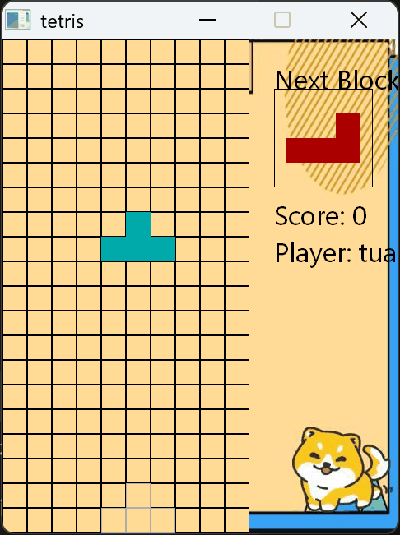
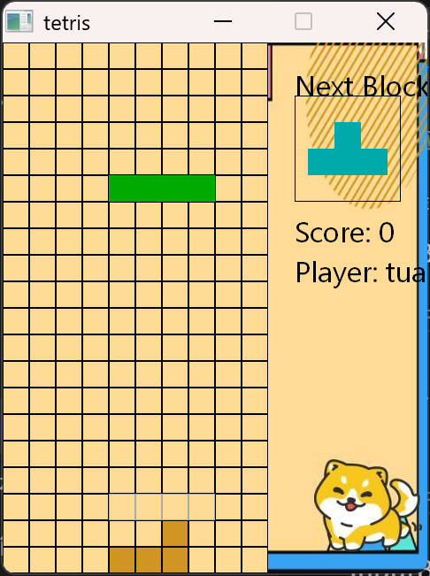

<div align="center">

# 俄罗斯方块 · Tetris

一个用 C++ 和 EasyX 写的俄罗斯方块，最初是大一实训课作业，
后来被重新做了一遍：拆模块、补单元测试、修掉内存泄漏和未定义行为，并让它能在 MinGW 下编译运行。

[](https://isocpp.org/)
[](tools/easyx-shim)
[](build.bat)
[](tests/test_board.cpp)
[](LICENSE)



</div>

---

## 目录

- [项目简介](#项目简介)
- [功能特性](#功能特性)
- [玩法与操作](#玩法与操作)
- [界面预览](#界面预览)
- [快速开始](#快速开始)
- [测试](#测试)
- [项目结构](#项目结构)
- [技术实现要点](#技术实现要点)
- [这次重构做了什么](#这次重构做了什么)
- [常见问题](#常见问题)
- [路线图](#路线图)
- [贡献](#贡献)
- [许可证](#许可证)

---

## 项目简介

**它是什么**：一个功能完整的桌面版俄罗斯方块——有玩家创建、三种难度、暂停、存档、排行榜、规则说明、BGM 与窗口尺寸设置。玩法、素材、界面布局都保持了最初作业的样子。

**它为什么被重写**：原始版本是一个 2872 行的 `main.cpp`，7 种方块各写一个子类，每类都把碰撞、锁定、绘制抄了一遍；方块用裸 `new` 分配且从不释放；一处固定块的写数组越界；没有任何测试。它能玩，但这些缺陷都会在代码评审时被一眼看穿。

**现在它是什么样**：按职责拆成 `Block / Board / Player / Leaderboard / Game` 五个模块，形状用一张数据表描述，棋盘规则与图形彻底解耦（所以能脱离窗口跑单元测试），并附了一个 EasyX 兼容层，让没有 Visual Studio + EasyX 的环境也能一条命令编译运行。

> 重构前的原始单文件版本保留在 [`legacy/main.cpp`](legacy/main.cpp)，方便对照。

## 功能特性

**玩法**

- 7 种标准方块（I / J / L / O / S / T / Z），每种拥有独立的旋转姿态数
- 三种难度，随难度提高下落速度
- 消行计分：一次消 1 / 2 / 3 / 4 行分别得 1 / 3 / 6 / 10 分
- **7-bag 随机**：7 种方块洗成一批依次发完，避免 `rand() % 7` 造成的长时间不来 I 块
- **幽灵落点**：用虚框提示当前方块最终会落在哪
- 下一个方块预览

**界面与交互**

- 15 个页面的完整状态机：主菜单、新建玩家、难度、游戏、暂停、结算、存档、排行榜、规则、设置（音乐 / 窗口尺寸 / 键位）
- 每页有背景插画与随页翻转的吉祥物
- 鼠标点击或键盘操作均可
- 方向键与 WASD 双键位可切换

**数据**

- 存档读写（最多 9 个存档位，格式与旧版完全兼容）
- 排行榜按分数排序，持久化到 `leaderboard.txt`

## 玩法与操作

| 操作 | 键位（默认） | 备选 |
| --- | --- | --- |
| 左移 | `←` | `A` |
| 右移 | `→` | `D` |
| 加速下落 | `↓` | `S` |
| 顺时针旋转 | `↑` | `W` |
| 暂停 / 继续 | `p` | 空格（可在设置里切换） |
| 返回上级菜单 | `Esc` | 右上角 `×` |

菜单里数字 `1`–`5` 对应各选项，也可以用鼠标点。

## 界面预览

| 主菜单 | 新建游戏 | 选择难度 |
| :---: | :---: | :---: |
|  |  |  |

| 游戏中 | 方块落地堆叠（含幽灵落点） |
| :---: | :---: |
|  |  |

## 快速开始

### 前置条件

- Windows（EasyX 与 GDI 依赖）
- 任选：MinGW-w64 / MSYS2（推荐，最省事），或 Visual Studio + 官方 EasyX
- 仓库自带的 `picture/`（界面插画）与 `music/`（BGM）；BGM 缺失不影响运行，只是没声音

### 方式一：一键脚本（MinGW-w64 / MSYS2）

```bat
build.bat
```

脚本会依次编译游戏、编译并运行单元测试，产物在 `build\tetris.exe`，静态链接，可以直接把 exe 拷到别处运行（记得带上 `picture\`）。

### 方式二：CMake

```bash
cmake -B build -G "MinGW Makefiles"
cmake --build build
ctest --test-dir build
```

### 方式三：Visual Studio + 官方 EasyX

`src/` 只依赖标准 EasyX 接口。在 VS 里新建空项目、装好 EasyX，把 `src/*.cpp` 加入工程即可。

> **注意**：不要给 VS 工程添加 `tools/easyx-shim` 的 include 路径。兼容层是给"没有 EasyX"的环境用的，和官方 EasyX 二选一。

### 手动编译（没有脚本时）

```bash
g++ -std=c++17 -O2 -static src/*.cpp tools/easyx-shim/graphics.cpp \
    -Isrc -Itools/easyx-shim -o tetris.exe \
    -lgdi32 -luser32 -lgdiplus -lwinmm
```

## 测试

棋盘的**全部规则**（碰撞、移动、旋转、消行、计分、结束判定）都不依赖图形接口，测试时链接 `graphics_stub.cpp`（所有绘图函数的空实现）即可，无需窗口环境。

```bash
g++ -std=c++17 -O2 tests/test_board.cpp src/Block.cpp src/Board.cpp \
    tools/easyx-shim/graphics_stub.cpp -Isrc -Itools/easyx-shim -o board_tests
./board_tests
```

覆盖范围：

| 测试 | 验证点 |
| --- | --- |
| 边界 | 贴左右墙不能再移动 |
| 旋转 | 顶部旋转会越界时被拒绝，姿态保持不变 |
| 碰撞 | 不能移进已固定的格子 |
| 消 1 行 | 得分 1，该行清空 |
| 消 2 行 | 得分 3，剩余格子正确下移 |
| 消 4 行 | 得分 10 |
| 顶行判定 | 顶行被占 → 判负 |
| 出生点 | 出生区被占 → 立即判负 |
| 锁定 | 形状的 4 个格子精确写入棋盘 |

## 项目结构

```
.
├── src/
│   ├── common.h          全局常量、BGI 调色板
│   ├── Block.h/.cpp      方块：形状 × 姿态的 CELLS 数据表 + 绘制
│   ├── Board.h/.cpp      棋盘：纯逻辑（碰撞/旋转/消行/7-bag/幽灵）+ draw()
│   ├── Player.h          玩家（值语义）
│   ├── Leaderboard.h/.cpp 排行榜（vector<Player>）
│   ├── Game.h/.cpp       页面状态机、菜单交互、存档
│   └── main.cpp          入口
├── tests/
│   └── test_board.cpp    棋盘逻辑单元测试（9 组）
├── tools/easyx-shim/     EasyX 兼容层（GDI/GDI+ 实现）
│   ├── graphics.h/.cpp   绘制、输入、InputBox、消息泵
│   └── graphics_stub.cpp 纯空实现，供单元测试链接
├── docs/screenshots/     截图与演示动图
├── legacy/main.cpp       重构前的单文件版本（仅存档，不参与构建）
├── picture/              界面插画（32 张）
├── music/                BGM
├── CMakeLists.txt
└── build.bat
```

## 技术实现要点

**1. 形状用数据表描述，而不是类继承**

7 个形状 × 各自的旋转姿态，全部压进一张表：

```cpp
// CELLS[形状][姿态][4 个格子] —— 每个姿态只需 4 个相对坐标
const Point CELLS[SHAPE_COUNT][4][4] = {
    /* I 横 */ {{0,1},{1,1},{2,1},{3,1}},
    /* I 竖 */ {{1,-1},{1,0},{1,1},{1,2}},
    ...
};
const int STATE_COUNT[SHAPE_COUNT] = {1,2,4,4,2,2,4};  // 各形状的姿态数
```

碰撞、锁定、绘制预览都变成"遍历这 4 个格子"，新增形状只改表，不动逻辑。原实现里约 800 行重复代码因此消失。

**2. 规则与绘图分离**

`Board` 的碰撞、旋转、消行、计分不出现任何图形调用，只有 `draw()` 依赖 EasyX。这是能写单元测试的前提——测试链接 `graphics_stub.cpp` 就把所有绘图函数变成空操作。

**3. EasyX 兼容层**

官方 EasyX 只支持 MSVC。`tools/easyx-shim` 用 GDI + GDI+ 实现了本项目实际用到的那一小撮 API（`initgraph` / `loadimage` / `putimage` / `fillrectangle` / `outtextxy` / `MouseHit` / `GetMouseMsg` / `InputBox` 等），只保证签名、常量、调用方式一致，不追求语义完全对齐。它让项目能在 MinGW 和 CI 里编译、运行、截图。

**4. 所有权明确**

方块用 `std::unique_ptr<Block>` 持有，`lockCurrent()` 里一句 `current_.reset()` 就归还；排行榜从 `vector<Player*>` 改为 `vector<Player>`，值语义，无悬垂指针。

**5. 意外收获：单元测试抓到一个真 bug**

```cpp
bool Board::collides(int nx, int ny, int nstate) const {
    // 旧实现：始终用当前姿态校验，nstate 参数被忽略
    for (const Point& c : CELLS[current_->shape][nstate]) { ... }  // 修复后
}
```

参数被忽略意味着**旋转时的碰撞校验用的是旧姿态**，贴墙旋转可能穿模。这类缺陷靠肉眼读代码很难发现，断言能直接把它顶到台面上。

## 这次重构做了什么

| 维度 | 之前 | 之后 |
| --- | --- | --- |
| 文件组织 | 单个 2872 行 `main.cpp` | 5 个模块 + 测试 + 兼容层 |
| 形状描述 | 7 个子类，碰撞/锁定/绘制各写一遍 | 一张 `CELLS` 数据表 |
| 重复代码 | 约 800 行 | 0 |
| 内存 | 裸 `new`，从不 `delete` | `unique_ptr` / 值语义 |
| 旋转判定 | 忽略目标姿态（可穿模） | 按目标姿态校验 |
| 结束时机构 | 出生点重叠几帧才判负 | 出生点被占立即判负 |
| 菜单循环 | 忙等待占满 CPU | 非游戏页 `Sleep(30)` |
| 吉祥物动画 | 按循环次数取模（会疯转） | 按时间驱动（600 ms 翻转） |
| 随机 | `rand() % 7`（可能长时间不来某形状） | 7-bag |
| 测试 | 无 | 9 组逻辑单测，零警告 |
| 构建 | Dev-C++ 工程文件 | `build.bat` + `CMakeLists.txt` |

**刻意没做的事**：不改玩法规则，不换图形框架，不重做美术与界面布局，不为了"看起来高级"引入依赖。落地即锁定取代旧版的触底缓冲，是为了换确定性——这个取舍写在[常见问题](#常见问题)里。

## 常见问题

**Q：双击 exe 黑屏 / 一闪就退出？**
A：程序以相对路径读取 `picture/`，必须在**仓库根目录**下运行，例如 `cd 仓库根目录 && build\tetris.exe`。缺少图片时窗口会是空的。

**Q：中文全是乱码？**
A：源文件是 UTF-8。用 MSVC 编译时加 `/utf-8`；Dev-C++ 需要在项目选项里把编码设为 UTF-8（原始版本用的是 GBK）。MinGW 下无需额外设置。

**Q：编译报错找不到 `graphics.h`？**
A：没加 include 路径。用 `-Itools/easyx-shim`（MinGW），或按[方式三](#方式三visual-studio--官方-easyx)用官方 EasyX 并去掉该路径。

**Q：为什么没有硬降（Hard Drop）和 Hold？**
A：属于"改变玩法"的范畴，重构阶段刻意不碰。已列入路线图。

**Q：为什么落地就锁，不能像现代方块那样再微调一下？**
A：旧版有触底缓冲，但依赖帧计时，行为不确定、难测试。现在改成确定性锁定，换来可测的规则。

**Q：存档 / 排行榜文件在哪？**
A：仓库根目录的 `save/` 与 `leaderboard.txt`。两者都在 `.gitignore` 里，不会污染提交。

## 路线图

- [ ] 硬降（空格）与 Hold 暂存
- [ ] 消行时的闪烁与下落动画
- [ ] 难度曲线可配置（外部 json 或 ini）
- [ ] 键位自定义，写入配置文件
- [ ] 把棋盘逻辑抽成不依赖任何平台的静态库，方便复用
- [ ] GitHub Actions：MinGW 下自动编译 + 跑单测

## 贡献

欢迎提 Issue 与 PR。约定几条：

1. 改动棋盘规则请**同时补单元测试**（`tests/test_board.cpp`），不然 CI 通过也不代表逻辑对
2. 保持 `src/` 的依赖方向：`Game → Board → Block`，不要反向包含
3. 新增形状或姿态只改 `CELLS` 表，不要在逻辑里写特判
4. 提交信息用「动词 + 对象」的中文短句，例如 `修复旋转时忽略目标姿态`

## 许可证

代码以 [Apache License 2.0](LICENSE) 发布。
界面插画与 BGM 为课程作业素材，仅用于学习演示，请勿商用。

---

<div align="center">

最初是作业，现在是一个可以拿来讲工程实践的小项目。
如果它对你有帮助，点个 Star 就是最好的鼓励。

</div>
