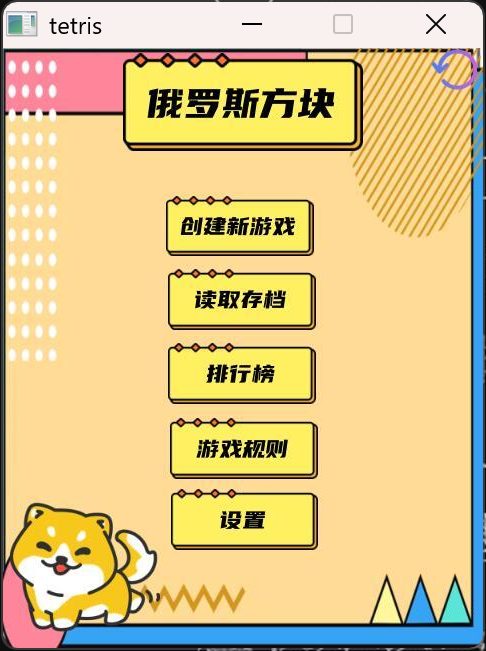
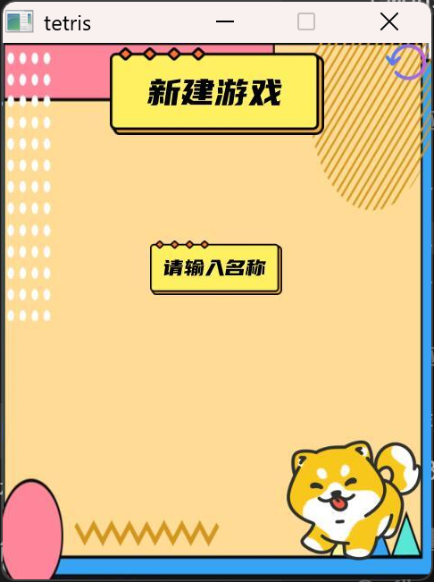
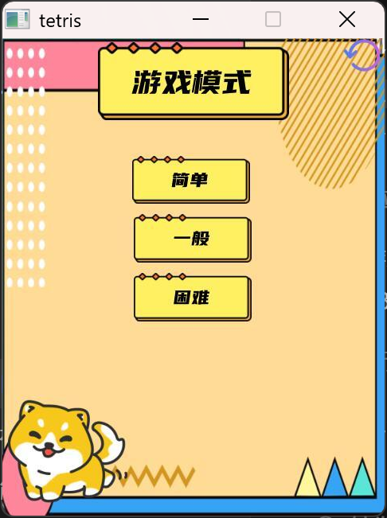
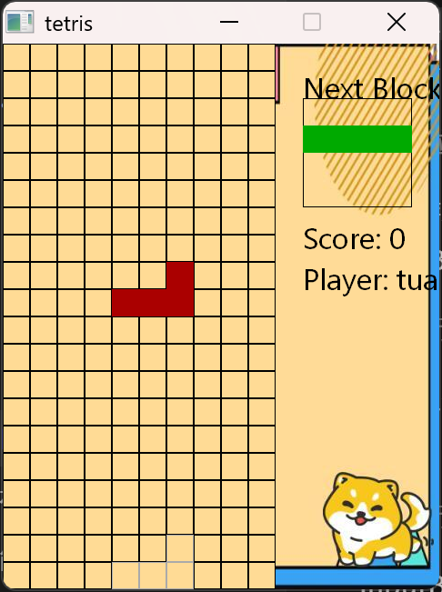

# 俄罗斯方块（C++ / EasyX）

大一实训课的作业，最初是一个 2800 行的单文件 `main.cpp`（见 [`legacy/`](legacy/)）。
后来把它当成一次**重构练习**：在不改变玩法和素材的前提下，把工程拆成模块、补上单元测试、修掉内存泄漏和未定义行为，并让它在 MinGW / CI 环境下也能编译运行。



## 特性

- 经典玩法：7 种方块、等级加速、消行计分（1/3/6/10）
- **7-bag 随机**：每种方块一轮内必出现一次，告别 `rand() % 7` 的连续干旱
- **幽灵落点**：虚框提示当前方块会落在哪里
- 完整菜单流程：创建玩家 / 存档读写 / 排行榜 / 规则 / 设置（音乐、窗口大小、键位切换）
- 方向键 **或** WASD 双键位，`p`（或空格）暂停
- 存档与排行榜为纯文本文件，格式与旧版完全兼容

| 新建游戏 | 模式选择 | 游戏中 |
| --- | --- | --- |
|  |  |  |

## 构建

### 方式一：一键脚本（MinGW-w64 / MSYS2）

```bat
build.bat
```

脚本会编译游戏、编译并运行单元测试，产物在 `build\tetris.exe`。
要求 `g++` 在 PATH 中（例如 MSYS2 的 mingw64 环境）， statically linked，可直接拷走运行。

### 方式二：CMake

```bash
cmake -B build -G "MinGW Makefiles"
cmake --build build
ctest --test-dir build
```

### 方式三：Visual Studio + 官方 EasyX

`src/` 只依赖标准 EasyX 接口。在 VS 里新建工程、安装 EasyX 后，把 `src/*.cpp` 加入工程即可，
**不要**把 `tools/easyx-shim` 加进 include path（shim 是给没有 EasyX 的环境用的兼容层）。

> 运行需要仓库根目录的 `picture/`（界面图）与 `music/`（BGM）；BGM 缺失不影响游戏运行，只是没有声音。

## 运行测试

棋盘逻辑（碰撞 / 移动 / 旋转 / 消行 / 结束判定）与图形完全解耦，单测通过链接一个空实现编译，无需窗口环境：

```bash
g++ -std=c++17 -O2 tests/test_board.cpp src/Block.cpp src/Board.cpp \
    tools/easyx-shim/graphics_stub.cpp -Isrc -Itools/easyx-shim -o board_tests
./board_tests
```

覆盖：贴墙边界、顶端旋转拒绝、固定块碰撞、1/2/4 行消除计分、顶行与出生点判负、锁定写入。

## 工程结构

```
src/
  common.h          全局常量、BGI 调色板
  Block.h/.cpp      方块：7 形状 × 姿态的 CELLS 数据表 + 绘制
  Board.h/.cpp      棋盘：纯逻辑（碰撞/消行/7-bag/幽灵落点）+ draw()
  Player.h          玩家（值语义）
  Leaderboard.h/.cpp 排行榜（vector<Player>，无裸指针）
  Game.h/.cpp       页面状态机、菜单交互、存档
  main.cpp          入口
tools/easyx-shim/   EasyX 兼容层（GDI/GDI+ 实现，让 MinGW/CI 也能编译）
tests/              棋盘逻辑单元测试
legacy/             重构前的原始单文件版本（仅存档，不参与构建）
```

## 这次重构改了什么

- **内存**：方块由裸 `new`/从不 `delete` 改为 `std::unique_ptr`，消除每落一块泄漏一次的缺陷
- **未定义行为**：原 `fixBlock` 无边界检查直接写数组 → 锁定统一走带边界的写入；出生点被占直接判负（旧版会重叠几帧才崩）
- **去重**：7 个方块子类里 ~800 行复制粘贴的碰撞/锁定/绘制 → 一张 `CELLS[7][4][4]` 数据表
- **修复旋转判定**：`collides()` 之前忽略目标姿态参数，旋转永远只按当前姿态校验
- **菜单卡顿**：主循环忙等待 → 非游戏页 `Sleep(30)` 节流；吉祥物翻转由循环计数改为按时间驱动
- **可测试**：棋盘逻辑不碰图形接口，9 组单测守护核心规则
- **兼容层**：`tools/easyx-shim` 用 GDI/GDI+ 实现了项目实际用到的 EasyX API 子集，让本项目能在没有 EasyX/MSVC 的机器上编译、跑起来、截图

## 已知取舍

- 落地为即触即锁，没有旧版"触底缓冲后仍可微调"的手感（换确定性）
- 暂无硬降（Hard Drop）与 Hold 功能，欢迎 PR
